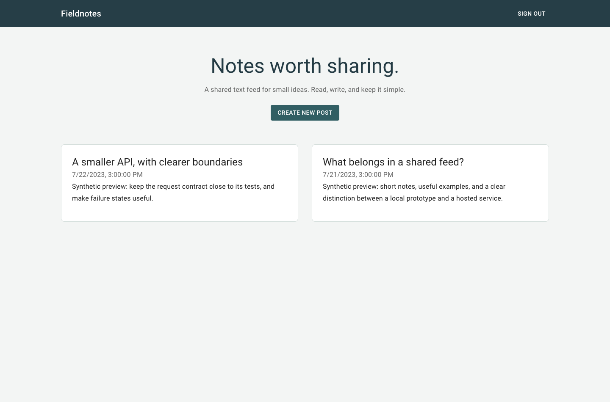

# Fieldnotes browser client

A React/Material UI client for a small shared blog API. Users can register, sign in, read the shared text feed, and publish a post. This repository contains the browser app only; it does not include a database, server, private post workspace, or editing/deletion workflow.



The UI overlaps the browser package in [blog-platform-monorepo](https://github.com/dev-nezuko/blog-platform-monorepo). Its reviewed session/error-handling changes are kept consistent here. The matching synthetic [desktop](docs/blog-desktop.png) and [mobile](docs/blog-mobile.png) screenshots are reused from that implementation, rather than presented as a different product. They show intercepted sample responses, not a live account.

## Start with the API contract

The companion [blog-content-api](https://github.com/dev-nezuko/blog-content-api) supplies:

| Request | Browser action |
| --- | --- |
| `POST /auth/signup` | Register `name`, `email`, `password` |
| `POST /auth/login` | Read the token from `payload.authtoken` |
| `GET /posts` | Read `payload`, an array of shared posts |
| `POST /posts` | Publish `title` and `content` |

These paths are relative to the configured `/api` base. Post requests use the custom `authtoken` header. There are no backend calls to update/delete a post, revoke a token, upload images, or load a private account feed.

## Local development

Use Node.js 22 and Yarn 1; the checked-in lock is `yarn.lock`.

```sh
yarn install --frozen-lockfile --ignore-scripts
cp .env.example .env
yarn start
```

Open `http://localhost:3000`. `REACT_APP_API_URL` defaults to `http://localhost:8080/api`; it is public browser configuration and must never contain a secret. Start the companion API separately with its own private signing key and database setup. This app does not seed a database or create a demo account automatically.

```sh
yarn test --watchAll=false --runInBand
yarn build
```

Eleven existing component tests pass, and the CRA production build passes with legacy toolchain/header-naming warnings. A fresh Chrome check of this repository's build verifies mocked sign-in, feed, immediate authenticated post creation, sign out, failed feed loading, and desktop/390px layout. The screenshots were reused, while these interactions were verified again. No live PostgreSQL, native bcrypt, real account, or hosted backend was used.

## Session and form details

A request interceptor reads the current cookie each time, so publishing immediately after sign-in does not reuse a stale token. UI navigation starts from cookie presence instead of parsing a separate localStorage boolean. Server authorization still checks the actual token. The cookie lasts one hour, uses `SameSite=Strict`, and is `Secure` on HTTPS; it remains JavaScript-readable. Sign out removes it locally without server-side revocation.

Form submissions are awaited and disabled while pending. Network errors get a useful fallback instead of accessing a missing Axios response. The feed shows loading, empty, and failure states, and non-interactive post cards are articles. The shared text-input wrapper passes Formik field props rather than leaking internal metadata into the DOM.

## Portfolio scope and remaining work

This is the same exercise family as the combined monorepo and standalone API, so avoid pinning all three as separate achievements. The remaining work is session hardening, API pagination, better expiry recovery, runtime response validation, and a maintained build/dependency plan before deployment. There is no measured scale claim or claim of original authorship of the underlying exercise. The local Roboto package supplies fonts actually imported by the app; there is no unnecessary standalone font directory to remove.
